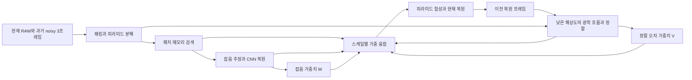

# MSTMN 재현 가능성 조사와 재현 계획

확인일: 2026-11-20 (Asia/Seoul). 범위: 1단계 조사·계획 작성.

평가 코드 후속 갱신: 사용자가 선택한 **공식 모델 연결용 평가 파이프라인**을 작성했다.
실제 CRVD 데이터 검사와 입력 복사 진단을 완료했으며, 공식 MSTMN 추론은 아직 수행하지 않았다.
[사용법](../docs/evaluation.md)과 [검증 기록](MSTMN_eval_validation.json)을 참조한다.

후속 갱신: 같은 날 추가 요청에 따라 Windows 서버에 Git과 **다운로드 전용 Python 가상환경**을 준비하고 **CRVD 시험용 scene 7–11의 GT/noisy ZIP 10개를 확보·검증하고 압축 해제**했다. 최신 실행 결과는 [다운로드·해제 완료 기록](CRVD_test_download_status.md), [다운로드 검증 목록](CRVD_test_download_inventory.json), [해제 파일 검증 목록](CRVD_test_extraction_inventory.json)을 참조한다. 아래 조사 내용 중 미다운로드·미설치 표기는 1단계 조사 당시의 상태이며, 모델 실행 환경 설치·구현·학습·평가는 수행하지 않았다.

**1단계 조사와 계획 작성은 완료했다. 재현 실행은 조건부 보류다.** 원문과 데이터 배포 경로는 확인했고 첫 목표를 정했다. 다만 공식 MSTMN 코드·가중치는 공개 여부를 확인하지 못했으며, 정확한 평가 집계·초기화 등 실행에 필요한 미확인 조건이 남아 있다. 공개되지 않았다고 단정하지 않는다.

첫 목표는 **Table III의 기본 MSTMN RAW 열: 평균 PSNR 42.92 dB / SSIM 0.9838**이다. 공식 체크포인트 확보 시 평가 재현부터 진행한다. 확보하지 못하면 자체 구현·학습 재현을 별도 범위로 계획한다. 1단계 조사에서는 모델 실행 환경 설치, 대용량 다운로드, 모델 구현, 학습·추론·벤치마크를 수행하지 않았다. 이후 승인된 데이터 확보 결과는 위 완료 기록에 별도로 정리했다.

## 1. 근거와 공개 자료

### 근거 표기

- **[P] 논문 명시:** 첨부 원문의 본문·그림·표에서 확인한 내용.
- **[C] MSTMN 공식 코드 확인:** 해당 저장소·실행 설정에서 확인한 내용. **현재 확인한 항목 없음.**
- **[D] 데이터 저자 공식 자료:** CRVD·Real-RawVSR 배포 README 및 CRVD 제공 코드. MSTMN 공식 코드와 구분한다.
- **[U] 미확인:** 본문만으로 확정할 수 없거나 접근하지 못한 내용. 논문에 반드시 누락됐다는 뜻은 아니다.
- **[R] 계획 제안·해석:** 이번 재현을 위한 선택. 논문의 설정이라고 취급하지 않는다.

[P]는 [사용자 제공 PDF](/Users/yhkim/Desktop/Multi-Scale_Spatio-Temporal_Memory_Network_for_Lightweight_Video_Denoising.pdf)를 뜻한다. 본문 14쪽 전체 텍스트와 URI를 확인하고, 구조·수식 및 실험 표가 있는 관련 페이지를 렌더링해 대조했다. 아래 `p.8 / 5817`은 PDF의 8번째 페이지와 인쇄 페이지 5817을 함께 나타낸다. PDF 페이지 n의 인쇄 페이지는 5809+n이다.

- 논문: *Multi-Scale Spatio-Temporal Memory Network for Lightweight Video Denoising*, Lu Sun, Fangfang Wu, Wei Ding, Xin Li, Jie Lin, Weisheng Dong, Guangming Shi.
- 출판: IEEE Transactions on Image Processing 33, pp.5810–5823 (2024), [DOI 10.1109/TIP.2024.3444315](https://doi.org/10.1109/TIP.2024.3444315).
- PDF SHA-256: `f6a17db1597850c7fb9c82a06b84b06c27c3ff6b792c13836006d657499e5c6d`.
- 이전 중간 보고서의 ‘원문 미확보’와 ‘데이터셋 후보’ 상태는 이 문서에서 갱신했다. PDF 내용은 분석 자료로만 취급했다.

### 공개·접근 상태

| 자료 | 상태 | 근거와 확인 범위 |
| --- | --- | --- |
| 출판 원문 | 확보·읽기 완료 | [P] 사용자 제공 PDF. [IEEE 출판 페이지](https://ieeexplore.ieee.org/document/10709843/)도 식별했다. 공개 PDF/프리프린트의 무료 접근 가능 여부는 별도로 미확인이다. |
| 공식 MSTMN 저장소 | 공개 여부 미확인 | [저자 공식 홈페이지](https://web.xidian.edu.cn/wsdong/)의 ‘近期工作’ 12번에 `Paper, project & code` 문구가 있으나 실제 연결된 코드 링크를 확인하지 못했다. [교신저자 대학 기록](https://faculty.xidian.edu.cn/WUFANGFANG/en/lwcg/437309/content/274213.htm)도 서지 정보만 제공했다. |
| 본문의 코드 공개 안내 | 찾지 못함 | [P] 14쪽 전체 텍스트와 PDF URI 점검에서 저장소·체크포인트·다운로드 안내를 찾지 못했다. 이것만으로 미공개라고 판정하지 않는다. |
| 공식 MSTMN 가중치 | 미확인 | 파일·모델 변형·학습 조건·접근 권한·이용 조건을 확인할 체크포인트 링크를 확보하지 못했다. |
| 보충자료 | 미확인 | 별도 공식 보충자료와 연결 링크를 확보하지 못했다. |
| CRVD | 공식 배포 링크·폴더 목록 확인 | [P] p.8 / 5817, IV-A에서 사용 확정. [D] [RViDeNet 공식 README, Dataset·Copyright](https://github.com/cao-cong/RViDeNet#dataset)에 Google Drive·MEGA·Baidu 배포 안내. [Google Drive](https://drive.google.com/drive/folders/1TZhNrsJ4tmKaU7b9b_9hkJIhwMi9Tfk3?usp=sharing)의 indoor GT/noisy·outdoor noisy 폴더 목록을 열람했다. 데이터 파일 다운로드는 하지 않았다. |
| Real-RawVSR | 공식 배포 링크 확인, 실제 데이터 접근 미확인 | [P] p.8–9 / 5817–5818에서 사용 확정. [D] [공식 README, Dataset·Copyright](https://github.com/zmzhang1998/Real-RawVSR#dataset)의 Baidu 링크 확인. 이번 도구의 랜딩 페이지 접근은 timeout이었다. 링크가 죽었다는 뜻은 아니다. |
| 데이터 이용 조건 | 공식 안내 확인 | [D] 두 데이터셋 README는 학술 목적·비상업 이용 및 CC BY-NC-SA 4.0을 명시한다. 사용 목적과 해당 배포본의 조건을 후속 확보 단계에서 확인해야 한다. |

접근 수준은 **소개 문구 → 링크 존재 → 파일 목록 열람 → 실제 파일 확보 → 해시·실행 검증**으로 구분했다. 데이터와 가중치의 실제 다운로드·실행 검증은 하지 않았다.

[sunlustar/MAP-VDNet](https://github.com/sunlustar/MAP-VDNet)은 다른 논문인 *Deep Maximum a Posterior Estimator for Video Denoising* (IJCV 2021)의 구현이다. MSTMN의 공식 코드로 취급하거나 설정을 대신 가져오지 않았다. 데이터 저자의 RViDeNet·Real-RawVSR 코드 역시 MSTMN의 공식 구현이 아니다.

## 2. 모델의 핵심 구성과 선행 개념

### 핵심 동작

직관적으로 MSTMN은 현재 프레임의 세부 정보, 이전에 복원한 프레임, 과거 noisy 프레임의 패치 정보를 모아 여러 해상도에서 복원한다. 전체 영상을 큰 신경망으로 반복 처리하기보다 피라미드와 작은 모듈의 조합으로 계산량을 줄인다. [P: III-A–D, p.3–8 / 5812–5817]

| 구성 | 논문에서 확인한 역할·설정 | 근거 |
| --- | --- | --- |
| MAP에 따른 설계 | 현재 관측의 잡음, 이전 복원과의 정렬 오차, CNN prior를 함께 고려해 복원·융합 구조를 유도 | [P] III-A, p.3–4 / 5812–5813, 식(3)–(10) |
| 다중 스케일 | Gaussian 4개 레벨과 Laplacian 3개 레벨. 5×5 Gaussian 필터와 1/2 다운샘플링. Laplacian 세부 성분을 복원하고 피라미드를 합성 | [P] III-B, p.4–5 / 5813–5814, Fig.2·식(11)–(13) |
| 메모리 | 과거 T개 noisy 프레임의 Gaussian을 key, Laplacian을 value로 사용. 패치 유사도에 sigmoid를 적용해 정보를 검색하고 현재 값과 결합 | [P] III-C, p.5 / 5814, Fig.3·식(14)–(15) |
| 메모리 비용 절감 | 완전한 메모리 검색은 높은 두 스케일에서 수행. 가장 낮은 스케일은 중간 스케일 검색 결과를 확대해 사용 | [P] p.6 / 5815, 식(16) 아래 |
| 입력 차원 변환 | RAW를 4채널로 pack하고 pixel-unshuffle로 해상도를 추가로 절반 줄여 16채널 처리. 복원 시 pixel-shuffle·pyramid collapse | [P] III-D, p.6–7 / 5815–5816, Fig.4 |
| 잡음 분산 경로 | read/shot noise 계수로 noise map을 만들고 enhanced Laplacian과 함께 denoiser에 입력. denoiser는 3×3 convolution 3층·16채널·ReLU로 설명 | [P] III-D-1, p.7 / 5816, 식(17)·Fig.5 |
| W·V 예측 | noise 경로의 W와 alignment 경로의 V는 픽셀별 대각 원소를 예측. 기본 예측기는 4층, hidden 16채널, 중간 depthwise separable 3×3, 양 끝 1×1, 마지막 1채널 sigmoid. 상위 스케일 가중치를 하위로 전달 | [P] III-D-1·2, p.7 / 5816 |
| 이전 복원의 정렬 | 가장 높은 피라미드 스케일에서 광학 흐름 [63]을 계산해 이전 복원 프레임을 warp. 흐름을 아래 두 스케일로 확대 | [P] III-D-2, p.7 / 5816 |
| 적응적 융합 | enhanced noisy Laplacian, 정렬된 이전 복원, CNN 복원을 W·V·(1−W−V)로 결합 | [P] 식(16c), p.6 / 5815; III-D-3, p.8 / 5817 |

**모델 전체를 optical-flow-free라고 설명하면 안 된다.** 초록의 정렬 비용 절감 설명과 달리 본문은 이전 복원 경로에서 광학 흐름을 명시한다. 패치 검색으로 별도 정렬을 피하는 메모리 경로와, 광학 흐름으로 정렬하는 순환 복원 경로를 구분해야 한다. [P: 초록; III-D-2, p.7 / 5816]

복원 한 단계의 개념도는 다음과 같다. 세부 실행 순서를 대신하는 구현 명세는 아니다.



### 필요한 선행 개념

| 개념 | 재현에 필요한 이해 |
| --- | --- |
| RAW·Bayer·패킹·ISP | 센서 모자이크, 채널 재배열, black/white level, 화면용 sRGB 변환은 서로 다른 처리다. RAW 지표와 sRGB 지표를 혼용하면 안 된다. |
| Poisson–Gaussian noise | 밝기에 따라 변하는 shot noise와 read noise를 함께 다룬다. 계수는 값의 단위·정규화에 의존한다. |
| Gaussian/Laplacian pyramid | 저주파 구조와 고주파 세부를 나누고, 작은 해상도에서 큰 움직임을 다룬 뒤 정보를 확대한다. |
| MAP와 CNN prior | 관측 오차와 복원 prior의 균형에서 가중 융합 구조를 유도한다. 논문은 이를 학습 가능한 모듈로 연결한다. |
| 순환 복원·warp | 이전 복원 프레임을 현재 시점으로 맞추고 다시 사용한다. 초기 상태·영상 경계·gradient 절단 방식이 결과에 영향을 줄 수 있다. |
| key/value와 패치 attention | 현재 key와 메모리 key의 유사도로 value를 가져온다. 이 논문은 Gaussian/Laplacian 표현과 sigmoid를 사용한다. |
| L1·PSNR·SSIM | 학습 손실과 평가 지표는 다르다. PSNR 값 범위와 SSIM 구현, 프레임·장면·ISO 평균 순서가 같아야 비교가 성립한다. |

### 모델 변형을 구분할 것

- **MSTMN:** 기본 one-step 경량 모델. 첫 재현 대상.
- **MSTMN-s:** 기본 모델 뒤에 두 번째 다중 스케일 복원 단계를 추가한다. 메모리 결합은 첫 단계에서 수행한다.
- **MSTMN+:** 채널·층·denoiser를 늘린 강화 모델. 단순히 기본 모델을 오래 학습한 것이 아니다.

변형의 구조 근거는 [P] IV-C, p.9–10 / 5818–5819, Fig.9다. 기본 모델, MSTMN-s, MSTMN+의 체크포인트·목표 수치를 섞지 않는다.

## 3. 데이터·전처리·학습·평가 조건의 근거 대장

### 데이터와 전처리

| 항목 | 확인한 내용 | 분류·위치 |
| --- | --- | --- |
| CRVD 센서·조건 | Sony IMX385, ISO 5개 조건 | [P] IV-A, p.8 / 5817 |
| CRVD 분할 | 실내 11장면 중 1–6 학습, 7–11 시험. 실외 50장면은 GT 없이 정성 비교 | [P] IV-A, p.8 / 5817 |
| ISO 값 | 1600, 3200, 6400, 12800, 25600 | [D] [CRVD 제공 synthesize_noise.py](https://github.com/cao-cong/RViDeNet/blob/master/synthesize_noise.py#L21-L23)의 `iso_list`; [P] Table IV에도 같은 5조건 표기 |
| Real-RawVSR 사용 | ×2 부분의 시험 영상 20개, 영상당 최대 51프레임, 해상도 1440×640 | [P] IV-A, p.8 / 5817 |
| Real-RawVSR 잡음 | ×2 부분의 고품질 영상에 Poisson–Gaussian 잡음을 추가해 denoising 추론. 초해상도 학습 실험으로 해석하지 않음 | [P] IV-C, p.9 / 5818 |
| CRVD 학습 잡음 | 실측 noisy만 쓰는지, GT에서 합성한 noisy를 추가/대체하는지 명확히 확정하지 못함. IV-A의 합성 설명은 학습·평가 범위를 분리하지 않음 | [U] p.8 IV-A와 p.9 IV-C를 함께 읽은 결과 |
| 패킹·crop | Bayer를 4채널로 pack한 후 128×128 패치로 crop | [P] IV-A, p.8 / 5817, 왼쪽 끝에서 오른쪽 상단으로 이어지는 문단 |
| pixel-unshuffle | 4채널 입력을 추가 공간 축소로 16채널 처리 | [P] III-D, p.6 / 5815 |
| CRVD 원 데이터 | Bayer GBRG, black=240, white=4095 | [D] [공식 README Dataset](https://github.com/cao-cong/RViDeNet#dataset). MSTMN 전처리 코드의 확인값은 아님 |
| Real-RawVSR 원 데이터 | Bayer RGGB, black=2047, white=16200 | [D] [공식 README Dataset](https://github.com/zmzhang1998/Real-RawVSR#dataset). MSTMN의 정규화·잡음 주입 구현은 미확인 |
| 채널 순서 대응 | 논문은 packed 순서를 `RGBG`로 표현. 센서 GBRG와 실제 인덱스 재배열의 대응이 필요 | [P] p.6 / 5815; [U] MSTMN 채널 인덱스 |
| 정규화·clip·증강 | black subtraction, data range, crop 좌표·공간 정합, augmentation, padding·resize의 정확한 구현 | [U] 공식 코드·저자 확인 필요 |

### 학습

| 항목 | 논문 명시 내용 | 근거 |
| --- | --- | --- |
| 입력 | 현재 noisy, 이전 복원, 과거 T개의 noisy 프레임 | [P] 식(18), p.8 / 5817 |
| 메모리 길이 | T=3. T=1,2,3,4 비교에서 3 이상 포화한다고 설명 | [P] IV-B-2, p.8 / 5817; Fig.6, p.9 / 5818 |
| 학습 시퀀스 길이 | 25 | [P] IV-A, p.8 / 5817, 오른쪽 상단 |
| batch size | 16 | 동일 |
| reconstruction loss | L1 | [P] 식(18), p.8 / 5817 |
| optimizer | Adam, β1=0.9, β2=0.999, ε=10⁻⁸ | [P] IV-A, p.8 / 5817 |
| learning rate | 초기 10⁻³, 15,000 iteration에서 5×10⁻⁴, 40,000에서 10⁻⁴ | 동일 |
| 전체 학습량 | 120,000 iterations | 동일. epoch 수로 바꾸지 않음 |
| 프레임워크·장치 | PyTorch, Nvidia Titan XP 1장 | 동일. 버전·실제 VRAM 사용량·학습 시간은 기재되지 않음 |
| 추가 학습 세부 | seed, weight decay, 초기화, gradient clipping, scheduler 경계 적용 시점, sequence loss reduction, TBPTT/detach, flow 고정/학습 여부, AMP·분산 학습 설정 | [U] 코드에서 확인하지 못함 |

25는 학습 시퀀스 길이이고, 3은 메모리에 넣는 과거 noisy 프레임 수다. 이 둘을 동일한 의미로 사용하지 않는다. 128×128은 **패킹 후 crop 설명**이며 원시 Bayer의 crop 크기와 혼동하지 않는다.

### 평가와 비용 측정

| 항목 | 확인한 내용 | 분류·위치 |
| --- | --- | --- |
| 주 정량 표 | CRVD 시험 평균, RAW 및 sRGB의 PSNR/SSIM | [P] Table III, p.9 / 5818 |
| ISP | sRGB 시각화에 [25]의 ISP 모델 사용 | [P] IV-C, p.9 / 5818. Table III의 sRGB 지표를 재현할 정확한 ISP checkpoint·설정은 [U] |
| 외부 데이터 평가 | Real-RawVSR ×2의 고품질 영상에 잡음을 합성, ISO별 비교 | [P] IV-C, p.9; Table IV, p.11 / 5820 |
| 초기·경계 처리 | 첫 프레임 복원 상태, t<3의 메모리 채움, warm-up 프레임의 평가 포함 여부 | [U] |
| 평가 manifest | CRVD의 실제 프레임 목록·noisy realization·반복 수, Real-RawVSR의 정확한 20개 시험 ID·GT 파일 선택 | [U] |
| 지표 세부 | PSNR data_range, clipping·양자화, 채널 처리, SSIM window·라이브러리, border exclusion | [U] |
| 평균 방식 | 프레임·영상·장면·ISO의 평균 순서와 가중치. 평균 PSNR인지 평균 MSE에서 계산한 PSNR인지 | [U] |
| 평가 부가 기법 | tile/overlap, self-ensemble, 후처리의 사용 여부 | [U] |
| 비교 모델 출처 | 다수 수치는 [28], BSVD는 [32]에서 가져옴. ReMoNet·Shift-Net 계열은 재학습. †는 경량화 변형 | [P] IV-C, p.9 / 5818 |
| 비용 시험 입력 | 1920×1080, 35프레임, 같은 Titan XP | [P] IV-D, p.9–10 / 5818–5819 |
| 비용 시험 수치 | MSTMN 13.73초, 5.10 GFLOPs | [P] Table V, p.11 / 5820 |
| 타이밍·FLOPs 세부 | GPU 동기화, warm-up, 반복 수, I/O·ISP·flow 포함 여부, 배치·정밀도, MAC/FLOPs 산정 관례 | [U] |

**35프레임은 Table V의 비용 시험 조건이다. CRVD 품질 평가의 전체 프레임 수라고 옮기지 않는다.** 13.73초는 35프레임 시험의 논문값이며, 프레임당 지연이나 사용자 장치의 예상 시간으로 쓰지 않는다. 5.10 GFLOPs 역시 구체적인 카운터와 산정 범위를 확인하기 전에는 동일한 측정이라고 주장할 수 없다.

## 4. 공식 코드 확인 사항과 주요 미확인 사항

### MSTMN 공식 코드

**[C]로 확인한 사항은 없다.** 저장소를 식별하지 못했으므로 commit SHA, 모델 파일, 데이터 로더, 실제 CLI 옵션, 평가 코드 행 번호를 제시할 수 없다. 논문 수치를 코드 기본값으로 둔갑시키지 않았다. 코드 공개 여부를 확정하려면 저자가 연결한 저장소 또는 저자의 안내가 필요하다. 저자에게 메시지를 보내지는 않았다.

### 데이터 저자 코드에서 확인한 보조 근거

[D] [CRVD 제공 synthesize_noise.py](https://github.com/cao-cong/RViDeNet/blob/master/synthesize_noise.py#L8-L23)의 `generate_noisy_raw`, `iso_list`, `a_list`, `b_list`를 확인했다. 확인일의 `master` 기준이며 commit SHA는 확보하지 못했다.

| ISO | a | b |
| --- | --- | --- |
| 1600 | 3.513262 | 11.917691 |
| 3200 | 6.955588 | 38.117816 |
| 6400 | 13.486051 | 130.818508 |
| 12800 | 26.585953 | 484.539790 |
| 25600 | 52.032536 | 1819.818657 |

해당 데이터 저자 함수는 black=240을 빼고 scaled Poisson 및 분산 b의 Gaussian 잡음을 더한 뒤 240을 복원하고 [0,4095]로 clip한다. 소스 주석은 a를 `sigma_s^2`, b를 `sigma_r^2`로 설명한다. **이것은 검증된 MSTMN 상수·잡음 생성 코드가 아니다.**

[P] 식(17)은 `n ~ N(0, σ_s y^G + σ_r²)`로 표현한다. 데이터 코드의 a/b와 논문의 σ 기호, 원시 DN과 정규화된 값의 대응을 확인해야 한다. 센서 범위가 다른 Real-RawVSR에 CRVD 계수를 어떻게 변환했는지도 미확인이다.

### 실행 전 해소하거나 가정을 기록할 항목

| 우선순위 | 문제 | 영향·필요한 근거 |
| --- | --- | --- |
| 필수 | 공식 코드·체크포인트 미확보 | 즉시 공식 평가 재현을 할 수 있는 상태가 아님. 코드/가중치를 확보하거나 자체 구현 경로를 선택해야 함 |
| 필수 | RAW 채널·값 범위·noise 계수 대응 | 잘못 맞추면 입력·잡음·지표가 달라짐. 실제 packing 인덱스, 정규화와 clip 위치 확인 |
| 필수 | 평가 프레임·평균·초기 상태 | Table III와 같은 집계가 되도록 manifest와 protocol 고정 |
| 필수 | 메모리 패치의 크기·stride·reshape·경계 | 식(14)의 패치 연산을 동일하게 구현할 세부값 미확인 |
| 필수 | flow 구현·가중치·입력·warp 세부 | [63]은 spatial pyramid optical flow 논문을 가리키지만 MSTMN에서 쓴 파일·체크포인트·freeze 여부는 미확인 |
| 학습 전 | CRVD 실측/합성 sampling과 sequence 학습 | noisy 선택·시간/장면 sampling·detach·loss 집계·seed 확인 |
| 확장 전 | ISP와 sRGB metric | RAW 재현을 먼저 끝내고 동일 ISP 확보 후 확장 |
| 비용 비교 전 | 타이머·정밀도·카운터 | Table V의 실행 시간·연산량과 비교 가능한지 먼저 판단 |

추가 표기 확인 사항: [P] 식(8), p.4 / 5813은 양의 제곱오차 합에 `argmax`를 적고 뒤에서 미분한 해를 제시한다. 오차 최소화 관점과의 부호 불일치는 오기 가능성으로 보이지만 **이는 해석**이다. 원문을 조용히 수정한 것처럼 설명하지 않는다. 구현을 진행한다면 저자 코드 또는 후속 확인으로 의도를 확정하고, CNN 학습 손실은 별도로 명시된 식(18)의 L1을 따른다.

## 5. 첫 재현 대상과 실험 조건 추천

### 첫 목표: Table III, 기본 MSTMN의 RAW 평균

[R] **Table III (p.9 / 5818), `MSTMN` 행의 RAW PSNR 42.92 dB / SSIM 0.9838**을 첫 정량 목표로 권한다.

선정 이유는 기본 one-step 모델이라 변형 혼동이 적고, 주 학습·시험 데이터인 CRVD를 사용하며, sRGB의 ISP 의존성을 우선 분리할 수 있기 때문이다. Table II 전수 ablation은 4개 변형의 학습이 필요하고, Real-RawVSR는 추가 데이터와 합성 잡음의 무작위성이 더해진다. Table V는 장치·측정법 영향이 커 초기 목표에서 제외한다.

| 고정할 항목 | 첫 실험 계획 | 근거·남은 조건 |
| --- | --- | --- |
| 모델 | MSTMN 기본형, one-step, T=3 | [P] III·IV-B; MSTMN-s/+ 제외 |
| 시험 데이터 | CRVD 실내 scene 7–11, ISO 5조건 전체 | [P] IV-A; ISO 값은 [D]. 실제 파일·프레임·noisy realization 목록은 확보 후 고정 |
| 학습 데이터 | 재학습 경로를 선택할 때 scene 1–6 | [P] IV-A. 시험 장면은 학습·튜닝에 사용하지 않음 |
| 목표 지표 | RAW 평균 42.92 dB / 0.9838 | [P] Table III. data_range·집계법·경계 정책은 미확인 상태로 실행하면 안 됨 |
| 입력·상태 | 논문의 패킹·피라미드·과거 noisy 3개·이전 복원 | 초기 상태·메모리·flow·프레임 순서의 정확한 규칙을 먼저 고정 |
| 평가 경로 | 공식 코드·가중치 확보 시 먼저 평가 재현 | 현재는 [U]. 가중치 없이 평가 재현 가능하다고 가정하지 않음 |
| 학습 경로 | 공식 가중치가 없고 자체 구현을 택할 경우 IV-A 설정으로 학습 | 데이터/모델 세부와 자원을 먼저 확인; 이번에는 구현·학습하지 않음 |
| 기능 점검 | 단일 scene·단일 ISO의 짧은 시퀀스 | [R] shape·값 범위·상태·metric 연결 확인용. Table III 목표와 직접 비교하지 않음 |
| 수치 판정 | 논문값과의 절대 차이를 PSNR·SSIM 각각 기록 | 허용 오차는 공식 실행 변동·표시 자릿수 등을 확인한 후 사전 정의. 근거 없이 0.01 dB 기준을 정하지 않음 |

Table III는 CRVD의 **전체 시험 평균**을 제공하며 ISO별 목표를 제공하지 않는다. 단일 ISO 결과를 42.92 dB와 비교해 성공·실패를 판단하지 않는다.

### 표의 값과 후속 우선순위

[P] Table III의 모델 변형별 목표:

| 모델 | RAW PSNR / SSIM | sRGB PSNR / SSIM | 표기 GFLOPs |
| --- | --- | --- | --- |
| MSTMN | **42.92 / 0.9838** | 38.43 / 0.9726 | 5.10 |
| MSTMN-s | 43.13 / 0.9853 | 38.54 / 0.9747 | 6.51 |
| MSTMN+ | 44.07 / 0.9880 | 40.03 / 0.9805 | 55.31 |

[P] Table II (p.8 / 5817)의 모듈 ablation:

| 다중 스케일 | 메모리 | PSNR / SSIM |
| --- | --- | --- |
| 없음 | 없음 | 42.15 / 0.9805 |
| 있음 | 없음 | 42.63 / 0.9832 |
| 없음 | 있음 | 42.44 / 0.9816 |
| 있음 | 있음 | 42.92 / 0.9838 |

이 표의 caption에는 RAW/sRGB 구분이 없다. 마지막 값이 Table III의 RAW 값과 같다는 점은 일관성 확인에 사용할 수 있지만, caption에 없는 도메인 설명을 직접 인용처럼 추가하지 않는다.

[R] 확장 순서는 Table III RAW 기본형 → 동일 결과의 sRGB → Table II ablation 또는 MSTMN-s → Table IV → Table V를 권한다. 자료 확보 상황에 따라 조정한다.

[P] Table IV (p.11 / 5820), Real-RawVSR ×2의 기본 MSTMN 값은 다음과 같다. 이 표는 별도 데이터에서 합성 잡음을 사용한 시험이다.

| ISO | PSNR | SSIM |
| --- | --- | --- |
| 1600 | 45.57 | 0.9897 |
| 3200 | 44.83 | 0.9874 |
| 6400 | 43.68 | 0.9828 |
| 12800 | 42.43 | 0.9771 |
| 25600 | 41.08 | 0.9656 |
| 표의 Average | 43.52 | 0.9805 |

[P] Table V (p.11 / 5820)의 기본 MSTMN 13.73초 / 5.10 GFLOPs, MSTMN-s 15.51초 / 6.51 GFLOPs는 위 비용 시험 조건의 수치다. 사용자 환경의 예상 소요 시간으로 환산하지 않았다.

## 6. 사용자 환경과 추가로 필요한 정보

실제 후속 실행 위치는 사용자가 지정한 **Windows SSH 서버의 `C:\Users\HP\yhkim`**이다. 아래 Mac 정보는 로컬 제어 장치의 점검 결과이며, 원격 서버의 자원은 8절에서 추가 확인했다.

이전 읽기 전용 점검 결과는 macOS 27.0.1 / arm64, MacBook Air(Mac16,12), Apple M4 CPU 10코어·GPU 10코어, 메모리 16 GB, Metal 지원이다. 프로젝트 볼륨의 가용 공간은 당시 약 87 GiB였다. 별도 VRAM 수치는 시스템 출력에서 확인되지 않았다.

근거 명령은 `uname -a`, `sw_vers`, `system_profiler SPHardwareDataType`, `system_profiler SPDisplaysDataType`, `df -h /Users/yhkim/Projects/denoising`이다. 이는 실행 환경 설치나 성능 시험이 아니다.

[P] 논문은 Nvidia Titan XP 한 장으로 학습했다고만 명시한다. **이 정보가 최소 요구 VRAM, M4에서의 실행 가능성, 예상 학습 시간을 알려주지는 않는다.** 16 GB 통합 메모리를 전부 GPU에 할당할 수 있다고 가정하지 않는다. 공식 코드의 CUDA·사용자 정의 연산·flow 의존성을 모르는 상태에서 MPS 호환이나 로컬 학습 가능 여부도 단정하지 않는다.

| 추가 정보 | 필요한 이유 | 현재 상태 |
| --- | --- | --- |
| 원격/서버 NVIDIA GPU 사용 가능 여부 | 논문의 실행 환경에 가까운 경로를 정하기 위함 | SSH 접근과 NVIDIA GPU 조회 확인, 8절 참조 |
| GPU 모델·개수·장치당 VRAM·점유 가능량 | batch 16·sequence 25 및 메모리 연산의 실제 수용 가능성 판단 | RTX PRO 6000 Blackwell Max-Q 1개, 총 97,887 MiB 확인. 지속 점유 가능량·작업별 사용량은 미확인 |
| 서버 OS·driver·CUDA·Python·PyTorch 현황 | 공식 코드/flow 의존성과 호환성 검토 | Windows 11 Pro for Workstations, driver 595.79. 후속 요청으로 Python 3.13.17·gdown 6.5.2 다운로드 전용 환경 준비 완료. CUDA toolkit·PyTorch 및 모델 호환성은 미확인 |
| 연속 실행 가능 시간·예산·재개 제약 | 작업 단위·checkpoint·중단 후 재개 계획 | 미확인 |
| CPU RAM·디스크 여유·I/O·데이터 위치 | 압축본·해제본·캐시·출력·checkpoint 동시 보관 가능성 판단 | 원격 RAM 127.65 GiB, 설치 전 여유 C: 865.13 GiB / E: 1,862.76 GiB. I/O·데이터 보관 위치·필요 총용량은 미확인 |
| CRVD 보유 여부·필요 파일 접근 권한 | 실내 GT/noisy·분할·ISO별 파일 확보 가능성 확인 | 후속 요청으로 시험 scene 7–11의 GT/noisy 10개 ZIP 확보, CRC·로컬 SHA-256 재검증 완료. 저장 위치 `E:\datasets`. 학습·outdoor 자료는 미확보 |
| Real-RawVSR 보유 여부·Baidu 접근 | Table IV를 후속 범위로 선택할 때 필요 | 미확인 |
| 기존 코드·가중치·저자 제공 자료 보유 여부 | 공개 검색으로 찾지 못한 공식 아티팩트를 재사용할 가능성 | 미확인 |
| 데이터 사용 목적 | 공식 데이터 이용 조건과의 적합성 확인 | 미확인 |

현재 단계에서 추가로 필요한 답은 **GPU 사용 시간·지속 점유 제약, 보유 데이터·코드·가중치의 위치**다. GPU 종류·총 VRAM과 SSH 작업 경로는 확인됐다. 실제 실행 계획의 필요 VRAM·시간·호환성은 아직 확정할 수 없다.

**소요 시간·필요 VRAM은 아직 추정하지 않는다.** 다음 실행 단계에서 실제 선택한 장치, 모델, 입력 크기, batch·sequence·T, 정밀도로 peak memory와 학습 step 시간·평가 처리량을 측정한다. 그 뒤 120,000 iteration 및 고정 평가 manifest의 수량을 근거로 I/O·평가·checkpoint 비용을 포함한 범위를 산정한다. 평가 처리량만으로 학습 시간을 계산하지 않는다.

## 7. 후속 작업의 작은 단계·산출물·완료 조건

다음은 1단계에서 작성한 모델 재현 계획이다. 이후 승인된 Git 설치는 8절, 다운로드 전용 환경과 CRVD 시험 데이터 확보·압축 해제는 [별도 완료 기록](CRVD_test_download_status.md)에 정리했다. 전처리·모델 구현·학습·평가는 아직 수행하지 않았다.

| 단계 | 작업 | 산출물 | 완료 조건 |
| --- | --- | --- | --- |
| 1 | 원문·공개성·설정·목표·자원 조사 | 이 보고서와 근거 대장 | 요청한 7항목을 채우고, 확인·미확인·제안을 구분; **이번 작업 완료** |
| 2A | 공식 아티팩트 경로 결정 | 저장소·commit·가중치 출처/해시·사용 조건 목록 또는 자체 구현 필요성 기록 | 모델 변형을 식별하고 공식 평가 경로의 존재 여부를 확정. 미확보 시 다음 경로를 명시 |
| 2B | 평가 프로토콜 확정 | RAW packing·normalization·noise·상태·frame manifest·metric·평균 규칙 | 코드/저자 근거를 기록하거나, 해소하지 못한 가정과 비교 한계를 실행 전에 문서화 |
| 2C | 환경 명세·자원 적합성 | 버전 고정 명세, 필요한 연산·장치 목록 | 설치 대상·flow 의존성·GPU 경로·저장 공간을 결정 |
| 3A | 필요한 데이터만 확보 | 파일 목록·출처·크기·해시·분할 manifest | CRVD 지정 장면·ISO·GT/noisy 대응이 모두 있고 분할 누수가 없음 |
| 3B | 환경 설치·최소 연산 검증 | 설치 로그·고정 환경·연산 점검 결과 | 선택 GPU에서 필수 연산·flow·데이터 읽기 동작 확인 |
| 3C | 공식 코드 평가 또는 구현 경로 점검 | 작은 시퀀스의 shape·범위·상태·출력 로그 | 누락/NaN 없이 입력부터 metric까지 연결. 자체 구현이면 먼저 모듈·수식 대응 설계를 리뷰 |
| 3D | 자원 소규모 측정 | peak memory·step 시간·평가 처리량·I/O 기록 | 실제 장치·설정에서 전체 실행의 시간·VRAM 범위를 근거와 함께 산정 |
| 4A | 공식 가중치 평가 재현 | 프레임/장면/ISO별 원시 지표·집계표·재실행 명령 | Table III 기본 MSTMN RAW 시험 전체를 고정 protocol로 처리하고 논문값과 차이 보고. 가중치가 없으면 이 단계는 적용 불가로 명시 |
| 4B | 학습 경로의 저장·재개 점검 | loss·gradient·checkpoint 저장/재개 로그 | 숫자 오류 없이 학습·저장·재개가 되며 sequence·loss·detach 정책이 고정됨 |
| 4C | 기본 모델 학습 재현 | 설정·seed·120,000 iteration 로그·checkpoint·동일 평가 결과 | 사전 고정한 학습량과 평가를 완료하고 편차·원인을 분석. 공식 평가와 독립 재학습을 구분 |
| 5A | sRGB·ablation·변형 확장 | Table III sRGB, Table II, MSTMN-s 등의 선택한 결과 | ISP·각 변형·별도 학습 조건을 기록하고 같은 비교 원칙 적용 |
| 5B | 외부 데이터·효율 확장 | Table IV·V 대응 결과와 측정 명세 | Real-RawVSR 잡음 realization과 시간/FLOPs 범위를 고정; 장치 차이를 함께 보고 |

자체 구현은 이번 범위에 포함되지 않는다. 향후 선택한다면 공식 코드 재현과 구분하고, 필수 미확인 사항을 설계 검토에서 먼저 해결한다. 코드/평가 조건이 끝내 확인되지 않으면 결과는 ‘명시한 가정에 따른 재구성’으로 보고하며 정확한 공식 재현이라고 부르지 않는다.

## 조사 범위와 검증 기록

Exa 검색을 원문·공식 코드/가중치·데이터의 세 관점으로 나누고, 알려진 1차 출처를 직접 열람했다. 이전 검색의 결과 요청 합계는 성공 호출 기준 113건(중복 포함)이며, 113개의 독립 전문을 읽었다는 의미는 아니다. 전 웹이나 GitHub를 빠짐없이 조사했다는 주장도 하지 않는다. 이번 원문 확보 후에는 전체 PDF의 링크와 본문을 다시 점검하고, 표 II–V와 핵심 구조·수식을 시각적으로 대조했다.

보고서의 수치와 출처 구분은 별도 검토로 교차 확인했다. 모델·데이터·환경에 대한 실행 검증은 수행하지 않았으며, 실제 재현 성공 여부는 아직 평가하지 않았다.

## 8. SSH 원격 환경 점검과 Git 설치

2026-11-20 사용자 요청에 따라 지정 서버에 SSH로 접속했다. 접속 비밀번호는 이 보고서·프로젝트 파일에 저장하지 않았다. 원격 작업 폴더는 `C:\Users\HP\yhkim`이며 점검 당시 비어 있었다. 서버의 다른 위치에 데이터나 환경이 없다는 뜻은 아니다.

| 항목 | 실제 확인 결과 |
| --- | --- |
| OS | Windows 11 Pro for Workstations, 64비트, build 26200 |
| GPU | NVIDIA RTX PRO 6000 Blackwell Max-Q Workstation Edition, 조회된 장치 1개 |
| 총 VRAM | `nvidia-smi` 기준 97,887 MiB, 약 95.59 GiB |
| GPU 메모리 사용량 | 점검 시 628 MiB. 이 값은 순간 관측이며 전용 사용 권한이나 학습 시 점유량을 뜻하지 않음 |
| NVIDIA driver | 595.79 |
| 물리 RAM | 127.65 GiB |
| C: 디스크 | 총 1,906.07 GiB, Git 설치 전 여유 865.13 GiB |
| E: 디스크 | 총 1,863.00 GiB, 점검 시 여유 1,862.76 GiB |
| Python | PATH에는 WindowsApps 실행 별칭만 확인. 실제 인터프리터·패키지 환경은 미확인 |
| CUDA toolkit·conda | PATH에서 `nvcc`·`conda`를 찾지 못함. 다른 위치의 설치까지 부재로 단정하지 않음 |
| WSL | 조회한 사용자별 배포판 등록을 찾지 못함. 설치·실행하지 않음 |

읽기 전용 확인은 `Get-CimInstance`, `Get-Command`, Git 설치 경로·등록 정보, `nvidia-smi --query-gpu` 및 지정 폴더의 목록으로 수행했다. 개인 자료나 다른 프로젝트를 검색하지 않았다.

Git은 PATH·일반 설치 경로·등록 정보에서 찾지 못해 WinGet의 `Git.Git` 패키지로 설치했다. 사용자 범위 및 `$env:LOCALAPPDATA\Programs\Git` 위치를 지정했다.

```powershell
winget install --id Git.Git --exact --source winget --scope user --location "$env:LOCALAPPDATA\Programs\Git" --silent --accept-package-agreements --accept-source-agreements --disable-interactivity
```

- 설치 명령 종료 코드: 0.
- 실제 설치 파일: `C:\Users\HP\AppData\Local\Programs\Git\cmd\git.exe`.
- 실제 버전: **`git version 2.56.0.windows.4`**. 최신 버전이라고 주장하지 않는다.
- 새 SSH 연결에서 작업 폴더로 이동한 뒤 `Get-Command git.exe`와 `git --version`이 정상 동작함을 확인했다. 별도 PATH 수정 명령 없이 확인됐다.
- Git 전역 사용자명·이메일, 저장소 초기화·복제, 모델 환경 설치·학습은 수행하지 않았다.

이 점검으로 원격 자원의 일부 미확인 사항을 해소했지만, 모델과 flow의 Windows·GPU 호환성이나 메모리 수용 가능성을 검증한 것은 아니다. 원격 하드웨어에서의 소요 시간은 추정하지 않았다.
